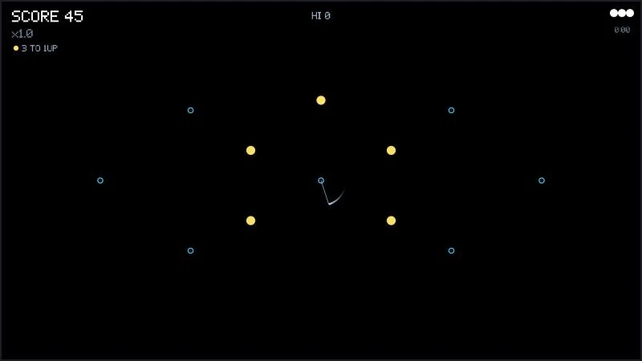

# Features

Comet is a one-button 2D swing game. It is a browser port of its first version, Comet2D, and keeps its rules, numbers, look and sounds.

## Swinging

Hold the button to latch onto the nearest live anchor and swing round it at a fixed radius. Let go to fly off along the swing. You can hold a direction to prefer the anchor that way. Hold on for four full turns and the tether snaps, with nothing for it.

## Chains and the multiplier

A long enough swing boosts your speed, scores, and adds to the chain. Every four swings in the chain add 0.5 to the score multiplier, up to x4. A release aimed at a mote close ahead is a perfect.

## Motes and lives

Motes give points, speed and extra lives. The HUD shows how many motes are left until the next one (**3 TO 1UP**). You start with three lives; crash and press to go again.

## It gets harder

The deadly edge creeps in from every side. Anchors rest longer after you use them and their reach shrinks. A new hazard bar appears every 30 seconds.

## High scores

A score in the top ten asks for three initials.

## Pause

Press `Esc` during a run for the pause menu: **Continue**, **Settings**, **Restart** and **Quit to title**. The settings (volumes, mono, stick dead zone, brightness, frame rate, full screen, reduce flashing and game speed) also open from the title with `Esc`; see [settings.md](settings.md).

## The look

A black field with flat colours, thin lines and a light system font, the same in the menus as on the field, letterboxed on black at 16:9.
